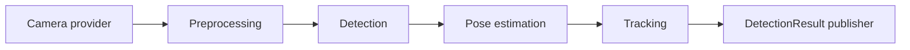

# Computer vision

[Shared integration contract](../INTEGRATION_README.md)

CV supplies prescribed bird observations from deterministic fixtures. It does
not detect objects from pixels, calculate tracking/docking geometry, decide
mission state, or issue motion commands. No PX4, ROS, waypoint planner, or
blocked-docking scenario is required.

## Coordinator interface

```python
from cv.computer_vision import ComputerVision

records = []
cv = ComputerVision(
    timestamp_mapper=lambda source_ns: source_ns,  # Explicit shared origin.
    log_sink=records.append,  # Coordinator-owned callable receiving a dict.
)
cv.start_camera("cv/scenarios/integration_cycle.json", camera_id="front")
try:
    for tick in range(200):
        cv.set_log_context(state="IDLE")  # Use the actual mission State.value.
        observation = cv.read_due(tick * 100_000_000)
        if observation is not None:
            bird = observation.to_bird_snapshot()
            # Coordinator puts bird in snapshot['bird']; Safety checks age.
except StopIteration:
    pass  # Controlled scenario completion, not camera failure.
finally:
    cv.stop_camera()
```

`read_due(now_ns)` consumes all samples due at the supplied simulation time and
returns the latest one. A 15 Hz fixture in a 10 Hz loop can consume more than one
sample per tick. Every consumed sample is logged. Before the first sample is
due it returns `None`; the coordinator must treat that as unavailable input.
Between samples it returns the cached immutable observation without changing
its timestamp or logging it again. Safety owns freshness decisions (the shared
default maximum age is 0.5 seconds).

The mapper must be pure and strictly increasing; use a fixed simulation-origin
offset, never the current tick time. `now_ns` must be a nonnegative integer and
must not move backwards. A finite source ends at the scheduled time of the
sample immediately after its last frame. `StopIteration` remains stable on
subsequent scheduled reads, and `exhausted` is true. Stop/start explicitly
restarts the fixture and scheduling clock. A jump beyond the end consumes/logs
remaining due samples and raises `StopIteration` in that call.

`read()` remains available for sequential frame export. Do not mix it with
`read_due()` in the same camera session. Sequential reads retain their existing
source-clock output and optional mapped time.

## Shared bird snapshot

`observation.to_bird_snapshot()` returns a fresh schema-version-1 dictionary:

- `detected`: true for a fixture bird, false for valid absence, null for missing input.
- `valid`, `camera_ok`, `reason`: missing frames are invalid with `missing_frame`.
- `type`, `distance_m`: prescribed fixture values, not measured geometry.
- `timestamp_ns`, `clock`: mapped sample time and `simulation`.
- `source_timestamp_ns`, `source_clock`: unchanged fixture time and `fixture`.
- `source_id`, `camera_id`, `frame_index`, `synthetic`: sample identity/provenance.

The adapter requires an explicit clock mapper. Valid absence and missing input
remain distinct. The coordinator may copy camera status into its environment
section, preserving the sample's validity/time; CV never overwrites unrelated
battery, environmental, or docking fields. Association with any separately
supplied synthetic target can use source ID, camera ID and frame index.

## Fixtures and logging

- `scenarios/bird_demo.json`: original looping image demo.
- `scenarios/integration_cycle.json`: finite 15 Hz appearance, brief absence,
  reappearance, prolonged absence, and missing frames.
- `scenarios/stale_samples.json`: 1 Hz stream; at a 10 Hz loop, cached samples
  exceed the 0.5-second freshness limit before the next sample arrives.

These fixtures prescribe observations only. They do not assert return, Safety
permissions, alignment, or touchdown. Existing scenario validation rejects
malformed booleans, missing observation fields, and invalid fixture distances.

Inject `log_sink` to route CV events through the coordinator's shared logger.
Records contain `State` and `Details` (module, event, and source/sample metadata).
The coordinator owns the full JSONL tick stream. The default compatibility sink
uses `universal_log/Universal_log.py`; its text logs are not that tick stream.
`to_dict()` keeps the legacy CV observation shape; `to_bird_snapshot()` is the
shared-loop adapter. The standalone image exporter uses its own schema v2.

## Setup and checks

From the repository root, in a Python environment:

```bash
python -m pip install -r cv/requirements.txt
python -m unittest discover -s tests -p test_computer_vision.py -v
python -m cv.synthetic_frames --scenario cv/scenarios/integration_cycle.json --headless --fast --once
```

OpenCV and NumPy generate optional fixture images and grayscale buffers; the
observations are still prescribed booleans. Front and downward camera IDs are
supported, but neither produces docking alignment or physical pose estimates.


## Phase 0 perception roadmap

Planned work, not current runtime behavior. CV answers **what the camera sees**:
acquisition, detection, camera-relative pose, object tracking, and observations.
Action selection remains with Navigation, Docking, Safety, and the coordinator.
Preserve the existing fixture API while developing the image-based pipeline.



### Providers and detection contract

Use a common provider interface (`read() -> FrameSample`, `close()`) for synthetic
images and recorded video, with physical cameras supported later. Samples carry
pixels, frame number, source/camera identity, capture timestamp and clock,
validity/reason, and calibration identity. Keep missing input, processing failure,
valid empty frames, and finite-source EOF distinct. Preserve source timestamps;
the coordinator owns clock mapping and scheduling.

Prefer the existing `CVObservation` interface and serialized field names wherever
they convey the required information. Extend it additively for perception; do not
replace it or introduce aliases solely to match the suggested terminology.

| Suggested information | Current interface | Decision |
| --- | --- | --- |
| Timestamp | `timestamp_ns`, `clock`, optional mapped simulation time | Keep; already explicit about units and clock |
| Source camera | `camera_id` | Keep; no `source_camera` alias needed |
| Confidence | Nullable `confidence` in the observation and `to_dict()` | Keep; currently unset by the fixture reader and omitted from `to_bird_snapshot()` |
| Object type | `bird_type`, serialized as `bird.type`; snapshot uses `type` | Keep for bird observations; use `type` for future generic detection entries |
| Object ID | None; `source_id` identifies the input source | Add per-object identity; do not repurpose `source_id` |
| X/Y/Z position | Only fixture `distance_m` | Add camera-relative position; scalar distance cannot encode 3D location |
| Orientation | None | Add nullable orientation |
| Tracking ID | None; `frame_index` identifies a frame | Add persistent track identity |

The current interface therefore covers part of the suggested contract, not all
of it. Preserve its availability/status, provenance, scheduling, and legacy bird
snapshot semantics. The standalone image exporter already has a `detections`
list (`label`, `bbox_xywh`, `confidence`), but it contains prescribed metadata,
not measured pose or persistent identity, and is not the runtime observation API.

Plan an optional generic `detections` collection alongside the existing bird
fields, with processing status and stage timings at frame level. Keep timestamps
and `camera_id` in the shared frame envelope rather than duplicating them per
object. Existing fixture-only callers must continue to work; distinguish an
unpopulated generic result from a successfully processed empty list. Version any
serialized extension explicitly and test legacy adapters. Generic detections do
not populate the legacy bird fields automatically.

Proposed per-object additions reuse existing terminology where applicable:

| Field | Meaning |
| --- | --- |
| `object_id`, `type` | Initially dictionary/marker ID and `aruco_marker`; `type` follows the existing serialized convention |
| `confidence`, `confidence_method` | Nullable score and its meaning; do not invent a probability |
| `position_x`, `position_y`, `position_z` | Marker-center translation in camera-relative metres; null without valid pose |
| `orientation` | Quaternion `{x,y,z,w}` rotating marker-frame vectors into camera-frame vectors |
| `tracking_id` | Camera/session-local track instance, distinct from marker identity |
| `corners_px` | Ordered image corners |
| `pose_valid`, `pose_reason`, `reprojection_error_px` | Pose validity and quality, independent of detection success |

Use camera axes x right, y down, z forward; marker axes x right, y up, z out of
the printed face. Record the solver's corner order. Metric pose requires camera
intrinsics, distortion, resolution, and physical marker size. Resizing/cropping
must preserve calibration consistency. A detection without calibration retains
its corners and identity with null pose. Missing quantities are null, not zero.

Camera coordinates require an explicit calibrated transform before use in the
integration loop's ENU frame. An ArUco detection must never become a bird
observation. Replacing synthetic docking alignment requires a validated adapter.

### Synthetic datasets and evaluation

Generate seeded scenes with calibrated marker geometry and separate ground-truth
manifests. The detector and tracker receive pixels, never truth metadata. Include
clean scenes, marker-free negatives, clutter, partial occlusion, variable lighting,
motion blur, rotation, scaling, and multiple markers. Save calibration, marker
sizes, poses, seeds, and degradation parameters for replay. Keep evaluation seeds
separate from tuning scenes.

Benchmark distance, rotation, lighting, projected scale, and occlusion. Physical
range requires known marker size and calibration; pixel resizing alone cannot
establish metres. Match predictions to truth one-to-one with declared identity
and image-position tolerances, counting duplicates as false positives. Report:

- Detection rate `TP/(TP+FN)`, precision, FP/FN counts, and false positives per
  negative frame, with sample counts and uncertainty intervals.
- X/Y/Z bias, MAE, RMSE, and p95 error; yaw/pitch/roll errors with a declared Euler
  convention and wrapped angles, plus quaternion angular error.
- Pose-valid coverage and failures separately from errors on successful poses.
- Maximum reliable tested range under a declared condition envelope and agreed
  detection/pose thresholds. Synthetic results do not establish hardware range.

### Tracking and instrumentation

Associate marker identities within each camera/session. Preserve track IDs over
a configured short gap, expire them using source time, and reset on source restart.
Flag duplicate marker IDs as ambiguous. Retained tracks must not appear as fresh
observations. Cross-camera association and prediction can wait.

Log every processed frame, including empty/failed frames, with timestamps, frame
number, detections, confidence, pose, track IDs, and processing times. Record run
configuration, software versions, calibration, dataset seed/manifest, and dropped
frames. Retain input media or a reproducible manifest for later investigation.

Measure acquisition, preprocessing, detection, pose estimation, tracking, and
publication with a monotonic performance clock. Publication timing covers the
local callback/queue operation; measure logging overhead separately. Report total
and stage p50/p95/p99 latency with machine, resolution, and sample counts.

### Implementation order and completion

1. Define frame/detection contracts and synthetic/recorded providers.
2. Detect ArUco markers from pixels and estimate calibrated pose in clean scenes.
   Include logging/timing hooks from the start.
3. Add degradation sweeps and reproducible detection/pose benchmark reports.
4. Add persistent tracking and complete latency reporting.
5. Integrate through explicit frame/time adapters while retaining fixture tests.

Acceptance requires the same detector to process synthetic images and recorded
video, reproducible benchmark reports, and logs explaining failures without drone
hardware. Test pixel behavior, pose accuracy, lifecycle errors, tracking expiry,
and evaluation accounting. Changing truth metadata alone must not change output.

Defer bird species classification, ML models, threat classification, behavior
prediction, deterrence selection, and autonomous mission planning.
